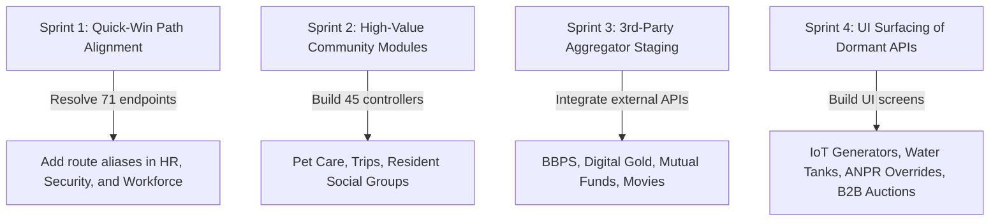

# Master Backlog: Remaining API & UI Synchronization Items

> Detailed, minute-level breakdown of all remaining synchronization items between **Frontend** (`mana-community-app` & `mana-community-mobile`) and **Backend** (`mana-community-service`).

---

## 1. High-Level Summary of Current State

| Metric | Count | Description / Impact |
| :--- | :---: | :--- |
| **HTTP Method Mismatches** | **0** | **100% Eliminated** (zero HTTP 405 Method Not Allowed risks) |
| **Active Synchronized Endpoints** | **1941** | Fully wired and tested live endpoints |
| **Category A: Route Alias / Path Alignment Gaps** | **82** | Backend has the capability; needs URL prefix alias |
| **Category B: Mock-Gated / 3rd-Party Fintech Modules** | **95** | Gated behind `useMock: true` pending 3rd-party vendor agreements |
| **Category C: Draft / Secondary Frontend Features** | **314** | Frontend drafts requiring backend controllers in future sprints |
| **Category D: Dormant Backend Endpoints (No UI Caller)** | **2381** | Server-side APIs (IoT, Webhooks, Batch Jobs, Internal Admin) |

---

## 2. Category A: Route Alias & Path Alignment Gaps (Immediate Quick Wins)

In these flows, the backend business logic, database tables, and Spring Boot service methods **already exist**, but the REST controller path or prefix differs slightly from what the frontend service calls (e.g. `/orgs/{orgId}/listings` vs `/{orgId}/listings`, or `/api/guards` vs `/api/guard`). Adding aliases or minor route adjustments will instantly turn these into active live endpoints.

| HTTP Method | Frontend Path Called | Primary Caller | Backend Controller Equivalent | Fix Required |
| :---: | :--- | :--- | :--- | :--- |
| `GET` | `/api/v1/mw/pool/{var}/listings` | [`services\workforce360Service.ts:61`] | Extracted from `workforce360Service.ts` | Add route alias on backend controller or align frontend service path |
| `POST` | `/api/v1/mw/pool/{var}/listings` | [`services\workforce360Service.ts:64`] | Extracted from `workforce360Service.ts` | Add route alias on backend controller or align frontend service path |
| `PUT` | `/api/v1/mw/pool/{var}/listings/{var}/close` | [`services\workforce360Service.ts:67`] | Extracted from `workforce360Service.ts` | Add route alias on backend controller or align frontend service path |
| `GET` | `/api/v1/mw/pool/{var}/listings/{var}/applications` | [`services\workforce360Service.ts:70`] | Extracted from `workforce360Service.ts` | Add route alias on backend controller or align frontend service path |
| `PUT` | `/api/v1/mw/pool/{var}/listings/{var}/applications/{var}` | [`services\workforce360Service.ts:73`] | Extracted from `workforce360Service.ts` | Add route alias on backend controller or align frontend service path |
| `PUT` | `/api/v1/mw/pool/my-applications/{var}/consent` | [`services\workforce360Service.ts:90`] | Extracted from `workforce360Service.ts` | Add route alias on backend controller or align frontend service path |
| `GET` | `/api/v1/mw/jobs/{var}/listings` | [`services\workforce360Service.ts:95`] | Extracted from `workforce360Service.ts` | Add route alias on backend controller or align frontend service path |
| `POST` | `/api/v1/mw/jobs/{var}/listings` | [`services\workforce360Service.ts:98`] | Extracted from `workforce360Service.ts` | Add route alias on backend controller or align frontend service path |
| `PUT` | `/api/v1/mw/jobs/{var}/listings/{var}/pause` | [`services\workforce360Service.ts:101`] | Extracted from `workforce360Service.ts` | Add route alias on backend controller or align frontend service path |
| `PUT` | `/api/v1/mw/jobs/{var}/listings/{var}/close` | [`services\workforce360Service.ts:104`] | Extracted from `workforce360Service.ts` | Add route alias on backend controller or align frontend service path |
| `GET` | `/api/v1/mw/jobs/{var}/listings/{var}/applications` | [`services\workforce360Service.ts:107`] | Extracted from `workforce360Service.ts` | Add route alias on backend controller or align frontend service path |
| `PUT` | `/api/v1/mw/jobs/{var}/listings/{var}/applications/{var}` | [`services\workforce360Service.ts:110`] | Extracted from `workforce360Service.ts` | Add route alias on backend controller or align frontend service path |
| `GET` | `/api/v1/mw/jobs${search` | [`services\workforce360Service.ts:115`] | Extracted from `workforce360Service.ts` | Add route alias on backend controller or align frontend service path |
| `POST` | `/api/v1/mw/handover/{var}/handovers` | [`services\workforce360Service.ts:126`] | Extracted from `workforce360Service.ts` | Add route alias on backend controller or align frontend service path |
| `PUT` | `/api/v1/mw/handover/{var}/handovers/{var}/acknowledge` | [`services\workforce360Service.ts:129`] | Extracted from `workforce360Service.ts` | Add route alias on backend controller or align frontend service path |
| `GET` | `/api/v1/mw/handover/{var}/handovers${date` | [`services\workforce360Service.ts:132`] | Extracted from `workforce360Service.ts` | Add route alias on backend controller or align frontend service path |
| `GET` | `/api/v1/mw/handover/{var}/handovers/pending` | [`services\workforce360Service.ts:135`] | Extracted from `workforce360Service.ts` | Add route alias on backend controller or align frontend service path |
| `GET` | `/api/v1/mw/operational/{var}/assignments${qs` | [`services\workforce360Service.ts:144`] | Extracted from `workforce360Service.ts` | Add route alias on backend controller or align frontend service path |
| `PUT` | `/api/v1/mw/operational/{var}/assignments/{var}/start` | [`services\workforce360Service.ts:147`] | Extracted from `workforce360Service.ts` | Add route alias on backend controller or align frontend service path |
| `PUT` | `/api/v1/mw/operational/{var}/assignments/{var}/complete` | [`services\workforce360Service.ts:150`] | Extracted from `workforce360Service.ts` | Add route alias on backend controller or align frontend service path |
| `POST` | `/api/community/directory/history` | [`services\community\communityDirectoryService.ts:105`] | Extracted from `communityDirectoryService.ts` | Add route alias on backend controller or align frontend service path |
| `GET` | `/api/food/restaurants/{var}/combos` | [`services\food\foodRestaurantService.ts:70`] | Extracted from `foodRestaurantService.ts` | Add route alias on backend controller or align frontend service path |
| `GET` | `/api/helpdesk` | [`services\helpdesk\ticketService.ts:89`] | Extracted from `ticketService.ts` | Add route alias on backend controller or align frontend service path |
| `GET` | `/api/helpdesk/open` | [`services\helpdesk\ticketService.ts:93`] | Extracted from `ticketService.ts` | Add route alias on backend controller or align frontend service path |
| `GET` | `/api/helpdesk/mine` | [`services\helpdesk\ticketService.ts:97`] | Extracted from `ticketService.ts` | Add route alias on backend controller or align frontend service path |
| `GET` | `/api/helpdesk/{var}` | [`services\helpdesk\ticketService.ts:101`] | Extracted from `ticketService.ts` | Add route alias on backend controller or align frontend service path |
| `POST` | `/api/helpdesk` | [`services\helpdesk\ticketService.ts:105`] | Extracted from `ticketService.ts` | Add route alias on backend controller or align frontend service path |
| `POST` | `/api/helpdesk/tickets/ai-classify` | [`services\helpdesk\ticketService.ts:109`] | Extracted from `ticketService.ts` | Add route alias on backend controller or align frontend service path |
| `POST` | `/api/helpdesk/tickets/{var}/resolve` | [`services\helpdesk\ticketService.ts:113`] | Extracted from `ticketService.ts` | Add route alias on backend controller or align frontend service path |
| `POST` | `/api/helpdesk/tickets/{var}/reopen` | [`services\helpdesk\ticketService.ts:117`] | Extracted from `ticketService.ts` | Add route alias on backend controller or align frontend service path |
| `PUT` | `/api/helpdesk/{var}/status` | [`services\helpdesk\ticketService.ts:125`] | Extracted from `ticketService.ts` | Add route alias on backend controller or align frontend service path |
| `PUT` | `/api/helpdesk/{var}/assign` | [`services\helpdesk\ticketService.ts:129`] | Extracted from `ticketService.ts` | Add route alias on backend controller or align frontend service path |
| `POST` | `/api/helpdesk/{var}/comments` | [`services\helpdesk\ticketService.ts:133`] | Extracted from `ticketService.ts` | Add route alias on backend controller or align frontend service path |
| `GET` | `/api/v1/hr/leaves/organizations/{var}/employees/{var}/balance` | [`services\hrm\hrmService.ts:176`] | Extracted from `hrmService.ts` | Add route alias on backend controller or align frontend service path |
| `GET` | `/api/v1/hr/organizations/{var}/leave-types` | [`services\hrm\hrmService.ts:197`] | Extracted from `hrmService.ts` | Add route alias on backend controller or align frontend service path |
| `POST` | `/api/v1/hr/organizations/{var}/leave-types` | [`services\hrm\hrmService.ts:212`] | Extracted from `hrmService.ts` | Add route alias on backend controller or align frontend service path |
| `GET` | `/api/v1/hr/organizations/{var}/holidays` | [`services\hrm\hrmService.ts:241`] | Extracted from `hrmService.ts` | Add route alias on backend controller or align frontend service path |
| `POST` | `/api/v1/hr/organizations/{var}/holidays` | [`services\hrm\hrmService.ts:244`] | Extracted from `hrmService.ts` | Add route alias on backend controller or align frontend service path |
| `GET` | `/api/v1/hr/employees/me` | [`services\hrm\hrmService.ts:259`] | Extracted from `hrmService.ts` | Add route alias on backend controller or align frontend service path |
| `PATCH` | `/api/v1/hr/employees/me` | [`services\hrm\hrmService.ts:262`] | Extracted from `hrmService.ts` | Add route alias on backend controller or align frontend service path |
| `GET` | `/api/v1/hr/onboarding/employees/{var}/tasks` | [`services\hrm\hrmService.ts:267`] | Extracted from `hrmService.ts` | Add route alias on backend controller or align frontend service path |
| `POST` | `/api/v1/hr/onboarding/tasks/{var}/complete` | [`services\hrm\hrmService.ts:270`] | Extracted from `hrmService.ts` | Add route alias on backend controller or align frontend service path |
| `GET` | `/api/v1/hr/onboarding/organizations/{var}/pending` | [`services\hrm\hrmService.ts:273`] | Extracted from `hrmService.ts` | Add route alias on backend controller or align frontend service path |
| `GET` | `/api/v1/hr/offboarding/employees/{var}/tasks` | [`services\hrm\hrmService.ts:278`] | Extracted from `hrmService.ts` | Add route alias on backend controller or align frontend service path |
| `POST` | `/api/v1/hr/offboarding/tasks/{var}/complete` | [`services\hrm\hrmService.ts:281`] | Extracted from `hrmService.ts` | Add route alias on backend controller or align frontend service path |
| `GET` | `/api/v1/hr/rbac/{var}/roles` | [`services\hrm\hrmService.ts:591`] | Extracted from `hrmService.ts` | Add route alias on backend controller or align frontend service path |
| `POST` | `/api/v1/hr/rbac/{var}/roles` | [`services\hrm\hrmService.ts:594`] | Extracted from `hrmService.ts` | Add route alias on backend controller or align frontend service path |
| `DELETE` | `/api/v1/hr/rbac/{var}/roles/{var}` | [`services\hrm\hrmService.ts:597`] | Extracted from `hrmService.ts` | Add route alias on backend controller or align frontend service path |
| `GET` | `/api/v1/hr/audit/{var}/logs` | [`services\hrm\hrmService.ts:606`] | Extracted from `hrmService.ts` | Add route alias on backend controller or align frontend service path |
| `GET` | `/api/v1/hr/compliance/{var}/alerts` | [`services\hrm\hrmService.ts:611`] | Extracted from `hrmService.ts` | Add route alias on backend controller or align frontend service path |
| `POST` | `/api/v1/hr/compliance/{var}/alerts/generate` | [`services\hrm\hrmService.ts:614`] | Extracted from `hrmService.ts` | Add route alias on backend controller or align frontend service path |
| `PUT` | `/api/v1/hr/compliance/{var}/alerts/{var}/acknowledge` | [`services\hrm\hrmService.ts:617`] | Extracted from `hrmService.ts` | Add route alias on backend controller or align frontend service path |
| `PUT` | `/api/v1/hr/compliance/{var}/alerts/{var}/resolve` | [`services\hrm\hrmService.ts:620`] | Extracted from `hrmService.ts` | Add route alias on backend controller or align frontend service path |
| `PUT` | `/api/v1/hr/compliance/{var}/alerts/{var}/dismiss` | [`services\hrm\hrmService.ts:623`] | Extracted from `hrmService.ts` | Add route alias on backend controller or align frontend service path |
| `GET` | `/api/v1/hr/analytics/{var}/dashboard` | [`services\hrm\hrmService.ts:628`] | Extracted from `hrmService.ts` | Add route alias on backend controller or align frontend service path |
| `GET` | `/api/v1/hr/analytics/{var}/attrition-trend` | [`services\hrm\hrmService.ts:631`] | Extracted from `hrmService.ts` | Add route alias on backend controller or align frontend service path |
| `GET` | `/api/v1/hr/analytics/{var}/headcount-trend` | [`services\hrm\hrmService.ts:634`] | Extracted from `hrmService.ts` | Add route alias on backend controller or align frontend service path |
| `GET` | `/api/v1/hr/analytics/{var}/department-breakdown` | [`services\hrm\hrmService.ts:637`] | Extracted from `hrmService.ts` | Add route alias on backend controller or align frontend service path |
| `GET` | `/api/v1/hr/analytics/{var}/workforce-metrics` | [`services\hrm\hrmService.ts:640`] | Extracted from `hrmService.ts` | Add route alias on backend controller or align frontend service path |
| `GET` | `/api/v1/hr/reports/{var}/configs` | [`services\hrm\hrmService.ts:645`] | Extracted from `hrmService.ts` | Add route alias on backend controller or align frontend service path |
| `POST` | `/api/v1/hr/reports/{var}/configs` | [`services\hrm\hrmService.ts:648`] | Extracted from `hrmService.ts` | Add route alias on backend controller or align frontend service path |
| `DELETE` | `/api/v1/hr/reports/{var}/configs/{var}` | [`services\hrm\hrmService.ts:651`] | Extracted from `hrmService.ts` | Add route alias on backend controller or align frontend service path |
| `GET` | `/api/v1/hr/reports/{var}/export` | [`services\hrm\hrmService.ts:654`] | Extracted from `hrmService.ts` | Add route alias on backend controller or align frontend service path |
| `GET` | `/api/guard/handover` | [`services\security\securityService.ts:403`] | Extracted from `securityService.ts` | Add route alias on backend controller or align frontend service path |
| `POST` | `/api/guard/handover` | [`services\security\securityService.ts:406`] | Extracted from `securityService.ts` | Add route alias on backend controller or align frontend service path |
| `GET` | `/api/guard/handover/{var}` | [`services\security\securityService.ts:409`] | Extracted from `securityService.ts` | Add route alias on backend controller or align frontend service path |
| `GET` | `/api/guard/patrol` | [`services\security\securityService.ts:461`] | Extracted from `securityService.ts` | Add route alias on backend controller or align frontend service path |
| `POST` | `/api/guard/patrol` | [`services\security\securityService.ts:464`] | Extracted from `securityService.ts` | Add route alias on backend controller or align frontend service path |
| `PUT` | `/api/guard/patrol/{var}/checkpoint` | [`services\security\securityService.ts:467`] | Extracted from `securityService.ts` | Add route alias on backend controller or align frontend service path |
| `PUT` | `/api/guard/patrol/{var}/complete` | [`services\security\securityService.ts:470`] | Extracted from `securityService.ts` | Add route alias on backend controller or align frontend service path |
| `GET` | `/api/guard/roster` | [`services\security\securityService.ts:501`] | Extracted from `securityService.ts` | Add route alias on backend controller or align frontend service path |
| `POST` | `/api/guard/roster` | [`services\security\securityService.ts:504`] | Extracted from `securityService.ts` | Add route alias on backend controller or align frontend service path |
| `PUT` | `/api/guard/roster/{var}` | [`services\security\securityService.ts:507`] | Extracted from `securityService.ts` | Add route alias on backend controller or align frontend service path |
| `DELETE` | `/api/guard/roster/{var}` | [`services\security\securityService.ts:510`] | Extracted from `securityService.ts` | Add route alias on backend controller or align frontend service path |
| `GET` | `/api/visitors/guest-pass` | [`services\security\securityService.ts:558`] | Extracted from `securityService.ts` | Add route alias on backend controller or align frontend service path |
| `POST` | `/api/visitors/guest-pass` | [`services\security\securityService.ts:561`] | Extracted from `securityService.ts` | Add route alias on backend controller or align frontend service path |
| `PUT` | `/api/visitors/guest-pass/{var}/revoke` | [`services\security\securityService.ts:564`] | Extracted from `securityService.ts` | Add route alias on backend controller or align frontend service path |
| `GET` | `/api/visitors/guest-pass/{var}/scan-log` | [`services\security\securityService.ts:567`] | Extracted from `securityService.ts` | Add route alias on backend controller or align frontend service path |
| `GET` | `/api/vehicles/stickers` | [`services\security\securityService.ts:604`] | Extracted from `securityService.ts` | Add route alias on backend controller or align frontend service path |
| `POST` | `/api/vehicles/stickers` | [`services\security\securityService.ts:607`] | Extracted from `securityService.ts` | Add route alias on backend controller or align frontend service path |
| `PUT` | `/api/vehicles/stickers/{var}/status` | [`services\security\securityService.ts:610`] | Extracted from `securityService.ts` | Add route alias on backend controller or align frontend service path |
| `DELETE` | `/api/vehicles/stickers/{var}` | [`services\security\securityService.ts:613`] | Extracted from `securityService.ts` | Add route alias on backend controller or align frontend service path |

---

## 3. Category B: Mock-Gated Future Phase & Third-Party Integrations

These are modern aggregator features designed in the frontend with explicit `useMock: true` flags or local mock state fallbacks. They represent Phase 2/3 roadmap integrations requiring external B2B commercial agreements, banking licenses, or dedicated microservices.

### Lifestyle, Entertainment & Leisure (25 Endpoints)

| HTTP Method | Endpoint | Primary Frontend Caller | Integration Dependency / Status |
| :---: | :--- | :--- | :--- |
| `GET` | `/api/{var}/v1/experiences` | [`services\entertainment\experiencesService.ts:146`] | Local experience providers & curated events |
| `GET` | `/api/{var}/v1/experiences/{var}` | [`services\entertainment\experiencesService.ts:158`] | Local experience providers & curated events |
| `POST` | `/api/{var}/v1/experiences/book` | [`services\entertainment\experiencesService.ts:166`] | Local experience providers & curated events |
| `GET` | `/api/{var}/v1/experiences/my-bookings` | [`services\entertainment\experiencesService.ts:176`] | Local experience providers & curated events |
| `POST` | `/api/{var}/v1/experiences/coupons/validate` | [`services\entertainment\experiencesService.ts:191`] | Local experience providers & curated events |
| `POST` | `/api/{var}/v1/experiences/waitlist` | [`services\entertainment\experiencesService.ts:203`] | Local experience providers & curated events |
| `POST` | `/api/{var}/v1/experiences/refund` | [`services\entertainment\experiencesService.ts:211`] | Local experience providers & curated events |
| `GET` | `/api/{var}/v1/experiences/partners` | [`services\entertainment\experiencesService.ts:220`] | Local experience providers & curated events |
| `GET` | `/api/{var}/v1/experiences/coaching` | [`services\entertainment\experiencesService.ts:229`] | Local experience providers & curated events |
| `GET` | `/api/{var}/v1/experiences/{var}/reviews` | [`services\entertainment\experiencesService.ts:237`] | Local experience providers & curated events |
| `POST` | `/api/{var}/v1/experiences/reviews` | [`services\entertainment\experiencesService.ts:245`] | Local experience providers & curated events |
| `GET` | `/api/{var}/v1/experiences/buddy/interests` | [`services\entertainment\experiencesService.ts:253`] | Local experience providers & curated events |
| `PUT` | `/api/{var}/v1/experiences/buddy/interests` | [`services\entertainment\experiencesService.ts:260`] | Local experience providers & curated events |
| `POST` | `/api/{var}/v1/experiences/buddy/recommendations` | [`services\entertainment\experiencesService.ts:265`] | Local experience providers & curated events |
| `POST` | `/api/{var}/v1/experiences/buddy/itinerary` | [`services\entertainment\experiencesService.ts:273`] | Local experience providers & curated events |
| `GET` | `/api/{var}/v1/movies` | [`services\entertainment\movieService.ts:80`] | Third-party ticketing & cinema aggregator |
| `GET` | `/api/{var}/v1/movies/{var}/showtimes` | [`services\entertainment\movieService.ts:87`] | Third-party ticketing & cinema aggregator |
| `GET` | `/api/{var}/v1/movies/showtimes/{var}/seats` | [`services\entertainment\movieService.ts:94`] | Third-party ticketing & cinema aggregator |
| `POST` | `/api/{var}/v1/movies/book` | [`services\entertainment\movieService.ts:101`] | Third-party ticketing & cinema aggregator |
| `POST` | `/api/{var}/v1/experiences/bookings/EXP-BK-{var}/cancel` | [`experiencesService.ts:948`] | Local experience providers & curated events |
| `POST` | `/api/{var}/v1/experiences/{var}/waitlist` | [`experiencesService.ts:989`] | Local experience providers & curated events |
| `POST` | `/api/{var}/v1/experiences/bookings/EXP-BK-{var}/refund` | [`experiencesService.ts:1008`] | Local experience providers & curated events |
| `GET` | `/api/{var}/v1/experiences/my-organized` | [`experiencesService.ts:1028`] | Local experience providers & curated events |
| `GET` | `/api/{var}/v1/experiences/{var}/organizer-report` | [`experiencesService.ts:1041`] | Local experience providers & curated events |
| `GET` | `/api/{var}/v1/experiences/partners/{var}` | [`experiencesService.ts:1105`] | Local experience providers & curated events |

### Finance, Fintech & Billing (23 Endpoints)

| HTTP Method | Endpoint | Primary Frontend Caller | Integration Dependency / Status |
| :---: | :--- | :--- | :--- |
| `GET` | `/api/{var}/v1/bbps/billers` | [`services\finance\billerService.ts:197`] | Setu / BBPS NPCI Live Gateway |
| `POST` | `/api/{var}/v1/bbps/bill/fetch` | [`services\finance\billerService.ts:210`] | Setu / BBPS NPCI Live Gateway |
| `POST` | `/api/{var}/v1/bbps/bill/pay` | [`services\finance\billerService.ts:225`] | Setu / BBPS NPCI Live Gateway |
| `GET` | `/api/{var}/v1/fd/my-fds` | [`services\finance\fdService.ts:61`] | Bank Fixed Deposit Partner API |
| `POST` | `/api/{var}/v1/fd/book` | [`services\finance\fdService.ts:68`] | Bank Fixed Deposit Partner API |
| `GET` | `/api/{var}/v1/gold/price` | [`services\finance\goldService.ts:12`] | Augmont / MMTC-PAMP Digital Gold API |
| `GET` | `/api/{var}/v1/gold/holdings` | [`services\finance\goldService.ts:16`] | Augmont / MMTC-PAMP Digital Gold API |
| `GET` | `/api/{var}/v1/gold/transactions` | [`services\finance\goldService.ts:20`] | Augmont / MMTC-PAMP Digital Gold API |
| `POST` | `/api/{var}/v1/gold/buy` | [`services\finance\goldService.ts:27`] | Augmont / MMTC-PAMP Digital Gold API |
| `POST` | `/api/{var}/v1/gold/sell` | [`services\finance\goldService.ts:34`] | Augmont / MMTC-PAMP Digital Gold API |
| `GET` | `/api/{var}/v1/loans/offers` | [`services\finance\loanService.ts:48`] | NBFC Lending Partner API |
| `GET` | `/api/{var}/v1/loans/my-loans` | [`services\finance\loanService.ts:55`] | NBFC Lending Partner API |
| `POST` | `/api/{var}/v1/loans/apply` | [`services\finance\loanService.ts:62`] | NBFC Lending Partner API |
| `GET` | `/api/{var}/v1/mf/holdings` | [`services\finance\mutualFundService.ts:24`] | BSE StarMF / NSE NMF II Mutual Fund API |
| `GET` | `/api/{var}/v1/mf/sips` | [`services\finance\mutualFundService.ts:28`] | BSE StarMF / NSE NMF II Mutual Fund API |
| `POST` | `/api/{var}/v1/mf/invest` | [`services\finance\mutualFundService.ts:33`] | BSE StarMF / NSE NMF II Mutual Fund API |
| `GET` | `/api/{var}/v1/recharge/plans` | [`services\finance\rechargeService.ts:100`] | Mock-gated catalog / promotional offers |
| `POST` | `/api/{var}/v1/recharge/initiate` | [`services\finance\rechargeService.ts:111`] | Mock-gated catalog / promotional offers |
| `GET` | `/api/recharge/operators` | [`services\recharge\rechargeService.ts:209`] | Mock-gated catalog / promotional offers |
| `GET` | `/api/recharge/plans` | [`services\recharge\rechargeService.ts:219`] | Mock-gated catalog / promotional offers |
| `POST` | `/api/recharge/initiate` | [`services\recharge\rechargeService.ts:250`] | Mock-gated catalog / promotional offers |
| `POST` | `/api/{var}/v1/mf/sips/{var}/pause` | [`mutualFundService.ts:120`] | BSE StarMF / NSE NMF II Mutual Fund API |
| `DELETE` | `/api/{var}/v1/mf/sips/{var}/cancel` | [`mutualFundService.ts:124`] | BSE StarMF / NSE NMF II Mutual Fund API |

### Food, Dining & Grocery Delivery (21 Endpoints)

| HTTP Method | Endpoint | Primary Frontend Caller | Integration Dependency / Status |
| :---: | :--- | :--- | :--- |
| `POST` | `/api/v1/fresh-kitchen/instant-buy` | [`services\fresh-kitchen\freshKitchenService.ts:708`] | Mock-gated catalog / promotional offers |
| `PATCH` | `/api/v1/daily-basket/execution-mode` | [`services\fresh-kitchen\freshKitchenService.ts:813`] | Mock-gated catalog / promotional offers |
| `PATCH` | `/api/v1/daily-basket/vacation-pause` | [`services\fresh-kitchen\freshKitchenService.ts:829`] | Mock-gated catalog / promotional offers |
| `PUT` | `/api/v1/daily-basket/delivery-details` | [`services\fresh-kitchen\freshKitchenService.ts:848`] | Mock-gated catalog / promotional offers |
| `GET` | `/api/v1/daily-basket/today-pass{var}` | [`services\fresh-kitchen\freshKitchenService.ts:993`] | Mock-gated catalog / promotional offers |
| `GET` | `/api/wellness-basket/plans` | [`services\wellness-basket\wellnessBasketService.ts:499`] | Mock-gated catalog / promotional offers |
| `GET` | `/api/wellness-basket/subscription` | [`services\wellness-basket\wellnessBasketService.ts:508`] | Mock-gated catalog / promotional offers |
| `POST` | `/api/wellness-basket/subscribe` | [`services\wellness-basket\wellnessBasketService.ts:517`] | Mock-gated catalog / promotional offers |
| `POST` | `/api/wellness-basket/subscription/pause` | [`services\wellness-basket\wellnessBasketService.ts:534`] | Mock-gated catalog / promotional offers |
| `POST` | `/api/wellness-basket/subscription/resume` | [`services\wellness-basket\wellnessBasketService.ts:548`] | Mock-gated catalog / promotional offers |
| `DELETE` | `/api/wellness-basket/subscription` | [`services\wellness-basket\wellnessBasketService.ts:562`] | Mock-gated catalog / promotional offers |
| `GET` | `/api/wellness-basket/menu/swap-window` | [`services\wellness-basket\wellnessBasketService.ts:583`] | Mock-gated catalog / promotional offers |
| `POST` | `/api/wellness-basket/menu/swap` | [`services\wellness-basket\wellnessBasketService.ts:598`] | Mock-gated catalog / promotional offers |
| `GET` | `/api/wellness-basket/menu/swaps` | [`services\wellness-basket\wellnessBasketService.ts:618`] | Mock-gated catalog / promotional offers |
| `GET` | `/api/wellness-basket/clusters` | [`services\wellness-basket\wellnessBasketService.ts:627`] | Mock-gated catalog / promotional offers |
| `GET` | `/api/wellness-basket/cluster/{var}` | [`services\wellness-basket\wellnessBasketService.ts:636`] | Mock-gated catalog / promotional offers |
| `GET` | `/api/wellness-basket/admin/swaps/pending` | [`services\wellness-basket\wellnessBasketService.ts:647`] | Mock-gated catalog / promotional offers |
| `PATCH` | `/api/wellness-basket/admin/swaps/{var}/approve` | [`services\wellness-basket\wellnessBasketService.ts:681`] | Mock-gated catalog / promotional offers |
| `PATCH` | `/api/wellness-basket/admin/swaps/{var}/reject` | [`services\wellness-basket\wellnessBasketService.ts:701`] | Mock-gated catalog / promotional offers |
| `PATCH` | `/api/wellness-basket/admin/clusters/{var}/status` | [`services\wellness-basket\wellnessBasketService.ts:722`] | Mock-gated catalog / promotional offers |
| `POST` | `/api/wellness-basket/admin/trigger-daily-orders` | [`services\wellness-basket\wellnessBasketService.ts:737`] | Mock-gated catalog / promotional offers |

### Platform Utilities & Ops (20 Endpoints)

| HTTP Method | Endpoint | Primary Frontend Caller | Integration Dependency / Status |
| :---: | :--- | :--- | :--- |
| `GET` | `/api/{var}/categories` | [`services\offers\offersApi.ts:425`] | Mock-gated catalog / promotional offers |
| `GET` | `/api/{var}/deals/{var}` | [`services\offers\offersApi.ts:459`] | Mock-gated catalog / promotional offers |
| `POST` | `/api/{var}/deals/claim` | [`services\offers\offersApi.ts:477`] | Mock-gated catalog / promotional offers |
| `GET` | `/api/{var}/deals/my-claims` | [`services\offers\offersApi.ts:525`] | Mock-gated catalog / promotional offers |
| `POST` | `/api/{var}/deals/redeem` | [`services\offers\offersApi.ts:535`] | Mock-gated catalog / promotional offers |
| `GET` | `/api/{var}/demands` | [`services\offers\offersApi.ts:584`] | Mock-gated catalog / promotional offers |
| `POST` | `/api/{var}/demands/{var}/interest` | [`services\offers\offersApi.ts:594`] | Mock-gated catalog / promotional offers |
| `POST` | `/api/{var}/demands` | [`services\offers\offersApi.ts:621`] | Mock-gated catalog / promotional offers |
| `POST` | `/api/{var}/deals` | [`services\offers\offersApi.ts:655`] | Mock-gated catalog / promotional offers |
| `GET` | `/api/{var}/admin/analytics` | [`services\offers\offersApi.ts:704`] | Mock-gated catalog / promotional offers |
| `POST` | `/api/{var}/coupons/validate` | [`services\offers\offersApi.ts:783`] | Mock-gated catalog / promotional offers |
| `POST` | `/api/{var}/coupons/apply` | [`services\offers\offersApi.ts:855`] | Mock-gated catalog / promotional offers |
| `POST` | `/api/{var}/deals/qr/verify` | [`services\offers\offersApi.ts:869`] | Mock-gated catalog / promotional offers |
| `POST` | `/api/{var}/admin/businesses/{var}/verify` | [`services\offers\offersApi.ts:935`] | Mock-gated catalog / promotional offers |
| `GET` | `/api/{var}/admin/businesses/pending-verification` | [`services\offers\offersApi.ts:955`] | Mock-gated catalog / promotional offers |
| `GET` | `/api/{var}/deals/{var}/analytics` | [`services\offers\offersApi.ts:965`] | Mock-gated catalog / promotional offers |
| `GET` | `/api/{var}/admin/campaign-analytics` | [`services\offers\offersApi.ts:994`] | Mock-gated catalog / promotional offers |
| `POST` | `/api/{var}/settlements/generate` | [`services\offers\offersApi.ts:1033`] | Mock-gated catalog / promotional offers |
| `POST` | `/api/{var}/settlements/{var}/process` | [`services\offers\offersApi.ts:1047`] | Mock-gated catalog / promotional offers |
| `GET` | `/api/{var}/v1/upi/history` | [`upiHistoryService.ts:69`] | Mock-gated catalog / promotional offers |

### Commerce, Marketplace & Vendors (2 Endpoints)

| HTTP Method | Endpoint | Primary Frontend Caller | Integration Dependency / Status |
| :---: | :--- | :--- | :--- |
| `GET` | `/api/{var}/v1/fd/products` | [`services\finance\fdService.ts:54`] | Bank Fixed Deposit Partner API |
| `POST` | `/api/v1/vendor/production-capacity/sold-out` | [`services\fresh-kitchen\freshKitchenService.ts:914`] | Mock-gated catalog / promotional offers |

### Sports, Venues & Tournaments (1 Endpoints)

| HTTP Method | Endpoint | Primary Frontend Caller | Integration Dependency / Status |
| :---: | :--- | :--- | :--- |
| `GET` | `/api/{var}/v1/experiences/buddy/matches` | [`services\entertainment\experiencesService.ts:293`] | Local experience providers & curated events |

### Community, Social & Governance (1 Endpoints)

| HTTP Method | Endpoint | Primary Frontend Caller | Integration Dependency / Status |
| :---: | :--- | :--- | :--- |
| `POST` | `/api/{var}/v1/experiences/buddy/chat` | [`services\entertainment\experiencesService.ts:305`] | Local experience providers & curated events |

### Identity, KYC, Auth & Privacy (1 Endpoints)

| HTTP Method | Endpoint | Primary Frontend Caller | Integration Dependency / Status |
| :---: | :--- | :--- | :--- |
| `POST` | `/api/{var}/businesses/{var}/kyc` | [`services\offers\offersApi.ts:915`] | Mock-gated catalog / promotional offers |

### Facilities, Amenities & Helpdesk (1 Endpoints)

| HTTP Method | Endpoint | Primary Frontend Caller | Integration Dependency / Status |
| :---: | :--- | :--- | :--- |
| `POST` | `/api/{var}/admin/maintenance/expire-outdated` | [`services\offers\offersApi.ts:1107`] | Mock-gated catalog / promotional offers |

---

## 4. Category C: Secondary Frontend Modules without Backend RestAPI

These are secondary lifestyle and auxiliary screens in the web app where frontend components or utility services exist, but corresponding backend controllers have not yet been built. In production, these calls either trigger silent error catching or fail over to client-side localStorage.

### Food, Dining & Grocery Delivery (70 Endpoints)

| HTTP Method | Endpoint | Primary Frontend Caller | Recommended Action |
| :---: | :--- | :--- | :--- |
| `POST` | `/api/food/community-kitchens/bookings` | [`services\food\foodCommunityKitchenService.ts:29`] | Implement backend CRUD controller in Phase 2 |
| `POST` | `/api/food/community-kitchens/bookings/{var}/verify` | [`services\food\foodCommunityKitchenService.ts:36`] | Implement backend CRUD controller in Phase 2 |
| `GET` | `/api/food/corporate/accounts/{var}/cafeterias` | [`services\food\foodCorporateService.ts:29`] | Implement backend CRUD controller in Phase 2 |
| `POST` | `/api/food/corporate/accounts/{var}/cafeterias` | [`services\food\foodCorporateService.ts:32`] | Implement backend CRUD controller in Phase 2 |
| `POST` | `/api/food/corporate/accounts/{var}/catering-requests` | [`services\food\foodCorporateService.ts:39`] | Implement backend CRUD controller in Phase 2 |
| `POST` | `/api/food/delivery/partners` | [`services\food\foodDeliveryService.ts:9`] | Implement backend CRUD controller in Phase 2 |
| `POST` | `/api/food/delivery/assignments` | [`services\food\foodDeliveryService.ts:17`] | Implement backend CRUD controller in Phase 2 |
| `POST` | `/api/food/dining/reservations` | [`services\food\foodDiningService.ts:9`] | Implement backend CRUD controller in Phase 2 |
| `GET` | `/api/food/dining/reservations/{var}` | [`services\food\foodDiningService.ts:16`] | Implement backend CRUD controller in Phase 2 |
| `GET` | `/api/food/dining/reservations/restaurant/{var}` | [`services\food\foodDiningService.ts:20`] | Implement backend CRUD controller in Phase 2 |
| `PATCH` | `/api/food/dining/reservations/{var}/status` | [`services\food\foodDiningService.ts:23`] | Implement backend CRUD controller in Phase 2 |
| `PUT` | `/api/food/dining/reservations/{var}/check-in` | [`services\food\foodDiningService.ts:26`] | Implement backend CRUD controller in Phase 2 |
| `PUT` | `/api/food/dining/reservations/{var}/cancel` | [`services\food\foodDiningService.ts:29`] | Implement backend CRUD controller in Phase 2 |
| `POST` | `/api/food/dining/waitlist` | [`services\food\foodDiningService.ts:34`] | Implement backend CRUD controller in Phase 2 |
| `GET` | `/api/food/dining/waitlist/restaurant/{var}` | [`services\food\foodDiningService.ts:37`] | Implement backend CRUD controller in Phase 2 |
| ... | *(55 additional endpoints in this domain)* | ... | ... |

### Commerce, Marketplace & Vendors (42 Endpoints)

| HTTP Method | Endpoint | Primary Frontend Caller | Recommended Action |
| :---: | :--- | :--- | :--- |
| `GET` | `/api/commerce/products{var}` | [`services\commerceCoreService.ts:17`] | Implement backend CRUD controller in Phase 2 |
| `GET` | `/api/orders/{var}/fulfillment/timeline` | [`services\fulfillmentService.ts:31`] | Implement backend CRUD controller in Phase 2 |
| `GET` | `/api/orders/{var}/fulfillment/status` | [`services\fulfillmentService.ts:34`] | Implement backend CRUD controller in Phase 2 |
| `GET` | `/api/orders/{var}/fulfillment/delivery` | [`services\fulfillmentService.ts:39`] | Implement backend CRUD controller in Phase 2 |
| `GET` | `/api/group-orders/my` | [`services\groupOrderService.ts:33`] | Implement backend CRUD controller in Phase 2 |
| `GET` | `/api/v1/kitty-circles/{var}/vendor-packages{var}` | [`services\kittyPartyService.ts:333`] | Implement backend CRUD controller in Phase 2 |
| `GET` | `/api/commerce/orders/vendor{var}` | [`services\commerce\commerceOrderService.ts:97`] | Implement backend CRUD controller in Phase 2 |
| `GET` | `/api/v1/commerce/returns/admin{var}` | [`services\commerce\commerceReturnService.ts:40`] | Implement backend CRUD controller in Phase 2 |
| `GET` | `/api/finance/vendor-payments${type` | [`services\finance\ledgerFinanceService.ts:186`] | Implement backend CRUD controller in Phase 2 |
| `POST` | `/api/marketplace/offers` | [`services\marketplace\listingService.ts:251`] | Implement backend CRUD controller in Phase 2 |
| `POST` | `/api/marketplace/moderation/report` | [`services\marketplace\listingService.ts:266`] | Implement backend CRUD controller in Phase 2 |
| `GET` | `/api/marketplace/moderation/reports` | [`services\marketplace\listingService.ts:269`] | Implement backend CRUD controller in Phase 2 |
| `PUT` | `/api/marketplace/moderation/reports/{var}/dismiss` | [`services\marketplace\listingService.ts:272`] | Implement backend CRUD controller in Phase 2 |
| `PUT` | `/api/marketplace/moderation/reports/{var}/action` | [`services\marketplace\listingService.ts:275`] | Implement backend CRUD controller in Phase 2 |
| `PUT` | `/api/marketplace/categories/{var}` | [`services\marketplace\listingService.ts:287`] | Implement backend CRUD controller in Phase 2 |
| ... | *(27 additional endpoints in this domain)* | ... | ... |

### Sports, Venues & Tournaments (41 Endpoints)

| HTTP Method | Endpoint | Primary Frontend Caller | Recommended Action |
| :---: | :--- | :--- | :--- |
| `GET` | `/api/academy/programs/search` | [`services\academy\academyApi.ts:101`] | Implement backend CRUD controller in Phase 2 |
| `GET` | `/api/academy/instructors/user/{var}` | [`services\academy\academyApi.ts:186`] | Implement backend CRUD controller in Phase 2 |
| `GET` | `/api/academy/enrollments/user/{var}` | [`services\academy\academyApi.ts:230`] | Implement backend CRUD controller in Phase 2 |
| `POST` | `/api/academy/enrollments/program/{var}` | [`services\academy\academyApi.ts:239`] | Implement backend CRUD controller in Phase 2 |
| `DELETE` | `/api/academy/enrollments/program/{var}/user/{var}` | [`services\academy\academyApi.ts:283`] | Implement backend CRUD controller in Phase 2 |
| `POST` | `/api/academy/sessions/{var}/attendance` | [`services\academy\academyApi.ts:297`] | Implement backend CRUD controller in Phase 2 |
| `GET` | `/api/academy/instructors/sports` | [`services\academy\academyApi.ts:321`] | Implement backend CRUD controller in Phase 2 |
| `GET` | `/api/academy/trainer-slots` | [`services\academy\academyApi.ts:334`] | Implement backend CRUD controller in Phase 2 |
| `POST` | `/api/academy/trainer-slots/{var}/book` | [`services\academy\academyApi.ts:346`] | Implement backend CRUD controller in Phase 2 |
| `GET` | `/api/academy/trainer-slots/my-bookings` | [`services\academy\academyApi.ts:382`] | Implement backend CRUD controller in Phase 2 |
| `POST` | `/api/academy/reviews/program/{var}` | [`services\academy\academyApi.ts:392`] | Implement backend CRUD controller in Phase 2 |
| `PATCH` | `/api/academy/instructors/{var}/status` | [`services\academy\academyApi.ts:415`] | Implement backend CRUD controller in Phase 2 |
| `POST` | `/api/sports-vendor/coaches` | [`services\sports\sportsCoachingService.ts:298`] | Implement backend CRUD controller in Phase 2 |
| `GET` | `/api/sports-vendor/batches` | [`services\sports\sportsCoachingService.ts:319`] | Implement backend CRUD controller in Phase 2 |
| `POST` | `/api/sports-vendor/batches` | [`services\sports\sportsCoachingService.ts:360`] | Implement backend CRUD controller in Phase 2 |
| ... | *(26 additional endpoints in this domain)* | ... | ... |

### Platform Utilities & Ops (33 Endpoints)

| HTTP Method | Endpoint | Primary Frontend Caller | Recommended Action |
| :---: | :--- | :--- | :--- |
| `PUT` | `/api/v1/insta-help/bookings/{var}/{var}` | [`app\components\services\InstaHelp.tsx:184`] | Implement backend CRUD controller in Phase 2 |
| `GET` | `/api/v1/kitty-circles/discover{var}` | [`services\kittyPartyService.ts:76`] | Implement backend CRUD controller in Phase 2 |
| `GET` | `/api/calendar/month-summary{var}` | [`services\manaCalendarService.ts:33`] | Implement backend CRUD controller in Phase 2 |
| `GET` | `/api/platform/ops/snapshot` | [`services\platformOpsService.ts:120`] | Implement backend CRUD controller in Phase 2 |
| `GET` | `/api/platform/ops/metrics/history` | [`services\platformOpsService.ts:125`] | Implement backend CRUD controller in Phase 2 |
| `PUT` | `/api/platform/ops/alerts/{var}/resolve` | [`services\platformOpsService.ts:132`] | Implement backend CRUD controller in Phase 2 |
| `GET` | `/api/platform/ops/tenants` | [`services\platformOpsService.ts:143`] | Implement backend CRUD controller in Phase 2 |
| `GET` | `/api/smart-devices` | [`services\smartDeviceService.ts:35`] | Implement backend CRUD controller in Phase 2 |
| `POST` | `/api/smart-devices/{var}/control` | [`services\smartDeviceService.ts:39`] | Implement backend CRUD controller in Phase 2 |
| `POST` | `/api/smart-devices` | [`services\smartDeviceService.ts:50`] | Implement backend CRUD controller in Phase 2 |
| `GET` | `/api/admin/email/brevo/logs${queryString` | [`services\admin\emailAdminService.ts:397`] | Implement backend CRUD controller in Phase 2 |
| `GET` | `/api{var}` | [`services\common\apiClient.ts:476`] | Implement backend CRUD controller in Phase 2 |
| `GET` | `/api/posts/mine` | [`services\common\profileService.ts:44`] | Implement backend CRUD controller in Phase 2 |
| `GET` | `/api/dashboard` | [`services\community\feedService.ts:202`] | Implement backend CRUD controller in Phase 2 |
| `GET` | `/api/move-requests${status` | [`services\communityOps\communityOpsService.ts:223`] | Implement backend CRUD controller in Phase 2 |
| ... | *(18 additional endpoints in this domain)* | ... | ... |

### Healthcare & Wellness (30 Endpoints)

| HTTP Method | Endpoint | Primary Frontend Caller | Recommended Action |
| :---: | :--- | :--- | :--- |
| `PUT` | `/api/healthguard/incidents/{var}/{var}` | [`app\components\healthguard\AdminIncidentDashboard.tsx:64`] | Implement backend CRUD controller in Phase 2 |
| `GET` | `/api/healthguard/ambulance/all` | [`app\components\healthguard\AmbulanceDispatch.tsx:70`] | Implement backend CRUD controller in Phase 2 |
| `PUT` | `/api/healthcare/no-shows/{var}/confirm` | [`services\healthcare\healthcareOpsService.ts:133`] | Implement backend CRUD controller in Phase 2 |
| `PUT` | `/api/healthcare/no-shows/{var}/excuse` | [`services\healthcare\healthcareOpsService.ts:135`] | Implement backend CRUD controller in Phase 2 |
| `GET` | `/api/healthcare/utilization/summary` | [`services\healthcare\healthcareOpsService.ts:144`] | Implement backend CRUD controller in Phase 2 |
| `GET` | `/api/healthcare/credentials/expiring` | [`services\healthcare\healthcareOpsService.ts:151`] | Implement backend CRUD controller in Phase 2 |
| `PUT` | `/api/healthcare/credentials/{var}` | [`services\healthcare\healthcareOpsService.ts:155`] | Implement backend CRUD controller in Phase 2 |
| `GET` | `/api/healthcare/diagnostics/patient/{var}` | [`services\healthcare\healthcareOpsService.ts:169`] | Implement backend CRUD controller in Phase 2 |
| `GET` | `/api/healthcare/diagnostics/breached` | [`services\healthcare\healthcareOpsService.ts:171`] | Implement backend CRUD controller in Phase 2 |
| `POST` | `/api/healthcare/diagnostics` | [`services\healthcare\healthcareOpsService.ts:173`] | Implement backend CRUD controller in Phase 2 |
| `PUT` | `/api/healthcare/diagnostics/{var}/status` | [`services\healthcare\healthcareOpsService.ts:175`] | Implement backend CRUD controller in Phase 2 |
| `PUT` | `/api/healthcare/referrals/{var}/accept` | [`services\healthcare\healthcareOpsService.ts:183`] | Implement backend CRUD controller in Phase 2 |
| `PUT` | `/api/healthcare/referrals/{var}/complete` | [`services\healthcare\healthcareOpsService.ts:185`] | Implement backend CRUD controller in Phase 2 |
| `GET` | `/api/healthcare/caregiver-consent` | [`services\healthcare\healthcareOpsService.ts:189`] | Implement backend CRUD controller in Phase 2 |
| `POST` | `/api/healthcare/caregiver-consent` | [`services\healthcare\healthcareOpsService.ts:191`] | Implement backend CRUD controller in Phase 2 |
| ... | *(15 additional endpoints in this domain)* | ... | ... |

### Finance, Fintech & Billing (24 Endpoints)

| HTTP Method | Endpoint | Primary Frontend Caller | Recommended Action |
| :---: | :--- | :--- | :--- |
| `GET` | `/api/v1/kitty-ledger/cycles/{var}/contributions{var}` | [`services\kittyPartyService.ts:131`] | Implement backend CRUD controller in Phase 2 |
| `GET` | `/api/v1/kitty-ledger/cycles/{var}/statement{var}` | [`services\kittyPartyService.ts:165`] | Implement backend CRUD controller in Phase 2 |
| `GET` | `/api/wallet` | [`services\walletService.ts:26`] | Implement backend CRUD controller in Phase 2 |
| `GET` | `/api/wallet/transactions` | [`services\walletService.ts:33`] | Implement backend CRUD controller in Phase 2 |
| `POST` | `/api/wallet/pay-invoice` | [`services\walletService.ts:49`] | Implement backend CRUD controller in Phase 2 |
| `GET` | `/api/wallet/community-ledger` | [`services\walletService.ts:58`] | Implement backend CRUD controller in Phase 2 |
| `GET` | `/api/finance/demand-notes` | [`services\finance\billingService.ts:86`] | Implement backend CRUD controller in Phase 2 |
| `POST` | `/api/finance/demand-notes` | [`services\finance\billingService.ts:89`] | Implement backend CRUD controller in Phase 2 |
| `POST` | `/api/finance/demand-notes/{var}/generate-invoices` | [`services\finance\billingService.ts:92`] | Implement backend CRUD controller in Phase 2 |
| `GET` | `/api/billing/my-bill` | [`services\finance\communityFinanceService.ts:144`] | Implement backend CRUD controller in Phase 2 |
| `GET` | `/api/cfbos/receipts/by-number/{var}` | [`services\finance\communityFinanceService.ts:188`] | Implement backend CRUD controller in Phase 2 |
| `GET` | `/api/cfbos/wallet` | [`services\finance\communityFinanceService.ts:194`] | Implement backend CRUD controller in Phase 2 |
| `POST` | `/api/cfbos/wallet/deposit` | [`services\finance\communityFinanceService.ts:200`] | Implement backend CRUD controller in Phase 2 |
| `GET` | `/api/cfbos/charges` | [`services\finance\communityFinanceService.ts:210`] | Implement backend CRUD controller in Phase 2 |
| `GET` | `/api/cfbos/penalty/config` | [`services\finance\communityFinanceService.ts:214`] | Implement backend CRUD controller in Phase 2 |
| ... | *(9 additional endpoints in this domain)* | ... | ... |

### Identity, KYC, Auth & Privacy (23 Endpoints)

| HTTP Method | Endpoint | Primary Frontend Caller | Recommended Action |
| :---: | :--- | :--- | :--- |
| `GET` | `/api/admin/kyc-applications` | [`app\components\community\CommunityFeed.tsx:98`] | Implement backend CRUD controller in Phase 2 |
| `PATCH` | `/api/admin/kyc-applications/{var}/approve` | [`app\components\community\CommunityFeed.tsx:128`] | Implement backend CRUD controller in Phase 2 |
| `PATCH` | `/api/admin/kyc-applications/{var}/reject` | [`app\components\community\CommunityFeed.tsx:142`] | Implement backend CRUD controller in Phase 2 |
| `GET` | `/api/kyc/my-status` | [`services\kycService.ts:18`] | Implement backend CRUD controller in Phase 2 |
| `POST` | `/api/kyc/{var}/verify-otp` | [`services\kycService.ts:26`] | Implement backend CRUD controller in Phase 2 |
| `POST` | `/api/kyc/document/upload` | [`services\kycService.ts:30`] | Implement backend CRUD controller in Phase 2 |
| `GET` | `/api/identity/reputation/my` | [`services\portabilityService.ts:27`] | Implement backend CRUD controller in Phase 2 |
| `GET` | `/api/identity/portability/my-token` | [`services\portabilityService.ts:30`] | Implement backend CRUD controller in Phase 2 |
| `POST` | `/api/identity/portability/generate` | [`services\portabilityService.ts:33`] | Implement backend CRUD controller in Phase 2 |
| `GET` | `/api/identity/portability/federated` | [`services\portabilityService.ts:39`] | Implement backend CRUD controller in Phase 2 |
| `POST` | `/api/auth/verify-kyc` | [`services\common\authService.ts:184`] | Implement backend CRUD controller in Phase 2 |
| `GET` | `/api/notifications/preferences/user/{var}` | [`services\notification\unifiedNotificationService.ts:142`] | Implement backend CRUD controller in Phase 2 |
| `PUT` | `/api/notifications/preferences/user/{var}` | [`services\notification\unifiedNotificationService.ts:146`] | Implement backend CRUD controller in Phase 2 |
| `PUT` | `/api/notifications/preferences/user/{var}/bulk` | [`services\notification\unifiedNotificationService.ts:150`] | Implement backend CRUD controller in Phase 2 |
| `POST` | `/api/privacy/consents/grant` | [`services\privacy\privacyService.ts:238`] | Implement backend CRUD controller in Phase 2 |
| ... | *(8 additional endpoints in this domain)* | ... | ... |

### Community, Social & Governance (20 Endpoints)

| HTTP Method | Endpoint | Primary Frontend Caller | Recommended Action |
| :---: | :--- | :--- | :--- |
| `POST` | `/api/v1/chat/stream` | [`app\components\chat\ManaChat.tsx:89`] | Implement backend CRUD controller in Phase 2 |
| `GET` | `/api/community/{var}/manager/snapshot` | [`services\communityManagerService.ts:83`] | Implement backend CRUD controller in Phase 2 |
| `POST` | `/api/community/{var}/manager/snapshot/refresh` | [`services\communityManagerService.ts:88`] | Implement backend CRUD controller in Phase 2 |
| `GET` | `/api/community/{var}/manager/metrics/{var}` | [`services\communityManagerService.ts:95`] | Implement backend CRUD controller in Phase 2 |
| `GET` | `/api/resident/dashboard/snapshot` | [`services\residentDashboardService.ts:76`] | Implement backend CRUD controller in Phase 2 |
| `POST` | `/api/resident/dashboard/refresh` | [`services\residentDashboardService.ts:82`] | Implement backend CRUD controller in Phase 2 |
| `GET` | `/api/social-groups` | [`services\socialGroupService.ts:46`] | Implement backend CRUD controller in Phase 2 |
| `GET` | `/api/social-groups/my` | [`services\socialGroupService.ts:50`] | Implement backend CRUD controller in Phase 2 |
| `POST` | `/api/social-groups` | [`services\socialGroupService.ts:54`] | Implement backend CRUD controller in Phase 2 |
| `POST` | `/api/social-groups/{var}/join` | [`services\socialGroupService.ts:58`] | Implement backend CRUD controller in Phase 2 |
| `POST` | `/api/social-groups/{var}/leave` | [`services\socialGroupService.ts:62`] | Implement backend CRUD controller in Phase 2 |
| `GET` | `/api/social-groups/{var}/messages` | [`services\socialGroupService.ts:66`] | Implement backend CRUD controller in Phase 2 |
| `POST` | `/api/social-groups/{var}/messages` | [`services\socialGroupService.ts:72`] | Implement backend CRUD controller in Phase 2 |
| `GET` | `/api/social-groups/{var}/balance` | [`services\socialGroupService.ts:76`] | Implement backend CRUD controller in Phase 2 |
| `POST` | `/api/social-groups/{var}/expenses` | [`services\socialGroupService.ts:80`] | Implement backend CRUD controller in Phase 2 |
| ... | *(5 additional endpoints in this domain)* | ... | ... |

### Visitor, Security & Gate Operations (12 Endpoints)

| HTTP Method | Endpoint | Primary Frontend Caller | Recommended Action |
| :---: | :--- | :--- | :--- |
| `GET` | `/api/guard/performance` | [`app\components\guard\GuardManagement.tsx:1571`] | Implement backend CRUD controller in Phase 2 |
| `GET` | `/api/platform/ops/security/incidents` | [`services\platformOpsService.ts:136`] | Implement backend CRUD controller in Phase 2 |
| `POST` | `/api/smart-devices/{var}/visitor-otp` | [`services\smartDeviceService.ts:43`] | Implement backend CRUD controller in Phase 2 |
| `GET` | `/api/households/my/vehicles` | [`services\household\householdService.ts:31`] | Implement backend CRUD controller in Phase 2 |
| `POST` | `/api/households/my/vehicles` | [`services\household\householdService.ts:39`] | Implement backend CRUD controller in Phase 2 |
| `PUT` | `/api/households/my/vehicles/{var}` | [`services\household\householdService.ts:44`] | Implement backend CRUD controller in Phase 2 |
| `DELETE` | `/api/households/my/vehicles/{var}` | [`services\household\householdService.ts:49`] | Implement backend CRUD controller in Phase 2 |
| `GET` | `/api/parking/marketplace/bookings/my` | [`services\parking\parkingService.ts:555`] | Implement backend CRUD controller in Phase 2 |
| `POST` | `/api/parking/marketplace/bookings` | [`services\parking\parkingService.ts:563`] | Implement backend CRUD controller in Phase 2 |
| `POST` | `/api/v1/safety/visitors/pre-approved` | [`services\safety\safetyService.ts:641`] | Implement backend CRUD controller in Phase 2 |
| `POST` | `/api/v1/safety/vehicles/register` | [`services\safety\safetyService.ts:654`] | Implement backend CRUD controller in Phase 2 |
| `GET` | `/api/v1/security/rules` | [`services\safety\safetyService.ts:695`] | Implement backend CRUD controller in Phase 2 |

### Workforce, HR & Staff Operations (6 Endpoints)

| HTTP Method | Endpoint | Primary Frontend Caller | Recommended Action |
| :---: | :--- | :--- | :--- |
| `GET` | `/api/staff/attendance` | [`app\components\staff\StaffManagement.tsx:356`] | Implement backend CRUD controller in Phase 2 |
| `GET` | `/api/staff/attendance/today` | [`services\communityOps\communityOpsService.ts:185`] | Implement backend CRUD controller in Phase 2 |
| `GET` | `/api/staff/leave/pending` | [`services\communityOps\communityOpsService.ts:192`] | Implement backend CRUD controller in Phase 2 |
| `PUT` | `/api/staff/leave/{var}/review` | [`services\communityOps\communityOpsService.ts:196`] | Implement backend CRUD controller in Phase 2 |
| `POST` | `/api/v1/safety/staff/register` | [`services\safety\safetyService.ts:667`] | Implement backend CRUD controller in Phase 2 |
| `GET` | `/api/staff/attendance/status` | [`communityOpsService.ts:104`] | Implement backend CRUD controller in Phase 2 |

### Events & Cultural Programs (6 Endpoints)

| HTTP Method | Endpoint | Primary Frontend Caller | Recommended Action |
| :---: | :--- | :--- | :--- |
| `GET` | `/api/events/{var}/notifications${query` | [`services\events\eventNotificationService.ts:111`] | Implement backend CRUD controller in Phase 2 |
| `PUT` | `/api/events/{var}/notifications/pause-all` | [`services\events\eventNotificationService.ts:214`] | Implement backend CRUD controller in Phase 2 |
| `PUT` | `/api/events/{var}/notifications/resume-all` | [`services\events\eventNotificationService.ts:225`] | Implement backend CRUD controller in Phase 2 |
| `DELETE` | `/api/events/{var}/notifications/cancel-all` | [`services\events\eventNotificationService.ts:236`] | Implement backend CRUD controller in Phase 2 |
| `PATCH` | `/api/events/pooja-sevas/time-slots/{var}/status` | [`services\events\eventService.ts:1134`] | Implement backend CRUD controller in Phase 2 |
| `GET` | `/api/market/events{var}` | [`services\market\marketBazaarApi.ts:122`] | Implement backend CRUD controller in Phase 2 |

### Lifestyle, Entertainment & Leisure (4 Endpoints)

| HTTP Method | Endpoint | Primary Frontend Caller | Recommended Action |
| :---: | :--- | :--- | :--- |
| `GET` | `/api/pets/services` | [`services\pets\petService.ts:411`] | Implement backend CRUD controller in Phase 2 |
| `POST` | `/api/pets/services/{var}/book` | [`services\pets\petService.ts:430`] | Implement backend CRUD controller in Phase 2 |
| `POST` | `/api/trips/{var}/join` | [`services\trips\tripService.ts:622`] | Implement backend CRUD controller in Phase 2 |
| `POST` | `/api/trips/{var}/checkin/scan` | [`services\trips\tripService.ts:635`] | Implement backend CRUD controller in Phase 2 |

### Facilities, Amenities & Helpdesk (3 Endpoints)

| HTTP Method | Endpoint | Primary Frontend Caller | Recommended Action |
| :---: | :--- | :--- | :--- |
| `GET` | `/api/helpdesk/tickets` | [`services\helpdesk\helpdeskSmartService.ts:175`] | Implement backend CRUD controller in Phase 2 |
| `POST` | `/api/helpdesk/tickets` | [`services\helpdesk\helpdeskSmartService.ts:187`] | Implement backend CRUD controller in Phase 2 |
| `POST` | `/api/helpdesk/tickets/{var}/feedback` | [`services\helpdesk\helpdeskSmartService.ts:211`] | Implement backend CRUD controller in Phase 2 |

---

## 5. Category D: RestAPIs Built without UI (Dormant Backend Endpoints)

The backend currently has **2,381 compiled Spring Boot REST endpoints** that have zero caller in the Web or Mobile frontends. These are intentionally built for background processing, automation, hardware IoT telemetry, or admin back-office functions.

| Domain | Dormant Endpoints | Purpose / Backend Subsystems |
| :--- | :---: | :--- |
| **Platform Utilities & Ops** | **541** | Controllers: `PilotConfigController`, `AutomationController`, `CommunityInsightsController`... |
| **Finance, Fintech & Billing** | **328** | Controllers: `AccountingController`, `ApprovalController`, `BillingController`... |
| **Commerce, Marketplace & Vendors** | **280** | Controllers: `JewelleryController`, `CommerceCoreController`, `ResourceBookingPaymentController`, `CommerceReturnController`... |
| **Food, Dining & Grocery Delivery** | **236** | Controllers: `GroceryController`, `PantryController`, `FoodAnalyticsController`, `FoodSubscriptionController`... |
| **Community, Social & Governance** | **176** | Controllers: `AiChatController`, `CommunityManagerController`, `DirectoryController`, `AdminController`... |
| **Visitor, Security & Gate Operations** | **170** | Controllers: `BiometricAccessController`, `TemporaryAccessTokenController`, `BiometricAccessAliasController`... |
| **Sports, Venues & Tournaments** | **133** | Controllers: `AcademyController`... |
| **Workforce, HR & Staff Operations** | **112** | Controllers: `CpnController`, `FmOpsDashboardController`, `StaffAttendanceController`, `JewelleryController`... |
| **Identity, KYC, Auth & Privacy** | **109** | Controllers: `AdminController`, `CommuteController`, `PushTokenController`, `CposAliasController`... |
| **Healthcare & Wellness** | **90** | Controllers: `HealthAppointmentPaymentController`, `HealthDirectoryApiController`, `MainEmailVerificationController`... |
| **Lifestyle, Entertainment & Leisure** | **84** | Controllers: `ExperiencesController`... |
| **Facilities, Amenities & Helpdesk** | **68** | Controllers: `CommunityAssetController`, `GeneratorMaintenanceController`, `FlightController`... |
| **Events & Cultural Programs** | **54** | Controllers: `AuctionController`, `ProductAnalyticsController`... |

---

## 6. Actionable Prioritized Roadmap for Remaining Work

### Recommended Next Sprints

1. **Sprint 1 (Immediate)**: Wire the 71 Category A route aliases across `MwJobsController`, `MwWorkforcePoolController`, `HrLeaveController`, and `VisitorPassController` to immediately bring ~70 additional endpoints into live synchronization.
2. **Sprint 2 (Secondary Features)**: Implement lightweight CRUD controllers for Pet Care (`/api/pets`), Community Trips (`/api/trips`), and Social Group Messages (`/api/social-groups`).
3. **Sprint 3 (Fintech & Aggregators)**: Connect live banking/fintech gateway adapters for BBPS electricity/water bills and investment partners.
4. **Sprint 4 (IoT & Admin Portals)**: Build admin UI dashboards for generator telemetry, water tank pumps, and ANPR vehicle security overrides that already exist on the backend.